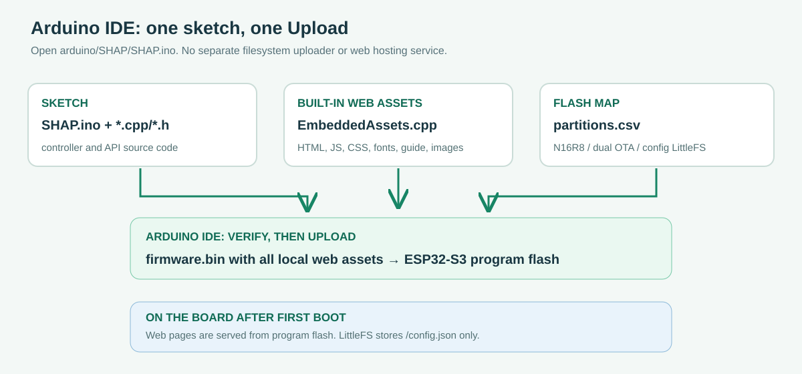

# نصب SHAP از صفر روی ESP32-S3 — راهنمای فارسی

این راهنما برای کسی است که **PlatformIO یا ابزار توسعه نصب نکرده** است. برای شروع فقط یک رایانهٔ متصل به اینترنت، کابل USB **داده‌دار** و برد **ESP32-S3-DevKitC-1 N16R8** لازم دارید. برد هدف باید **۱۶ مگابایت Flash از نوع QIO و ۸ مگابایت PSRAM از نوع OPI** داشته باشد؛ نام و حافظهٔ برد را از نوشتهٔ روی برد یا مشخصات سازنده بررسی کنید. فریمور برای این مشخصات در CI کامپایل شده، اما روی برد واقعی آزموده نشده است. برای نصب اولیه هیچ رله، برق شهر یا بار دیگری متصل نکنید.

> **این دستورها روی رایانه اجرا می‌شوند، نه در مرورگر یا داخل ESP32.** اتصال اینترنت برای بار اول لازم است: Python/PlatformIO بسته‌های Espressif، کامپایلر و کتابخانه‌ها را دریافت می‌کنند. فایل ZIP مخزن **کد منبع** است، نه فایل باینری آماده برای کپی روی حافظهٔ USB.

## ۱. پوشهٔ درست پروژه را دریافت و باز کنید

1. [صفحهٔ همین شاخهٔ پروژه در GitHub](https://github.com/wrappedman/Arduino-HomeController/tree/arena/8a6b6b7d-arduino-homecontroller) را باز کنید. **همین شاخه** را انتخاب کنید، سپس **Code → Download ZIP** را بزنید؛ ZIP را Extract کنید. اگر Git بلد هستید می‌توانید به‌جای ZIP این شاخه را clone کنید، اما Git برای این راهنما لازم نیست.
2. وارد پوشهٔ استخراج‌شده‌ای شوید که **`platformio.ini` مستقیماً داخل آن** است؛ داخل `src` یا `data` نروید. پوشه را در مسیری کوتاه و ترجیحاً بدون حروف غیرلاتین، مثلاً `C:\SHAP` یا `~/SHAP` بگذارید.
3. در Windows از File Explorer به این پوشه بروید و روی جای خالی راست‌کلیک → **Open in Terminal** (یا روی نوار آدرس `powershell` بنویسید و Enter بزنید). در macOS/Linux ترمینال را باز کنید و با `cd` به همین پوشه بروید. در ترمینال Windows دستور `dir platformio.ini` و در macOS/Linux دستور `ls platformio.ini` باید نام فایل را نشان دهد.



**کدام فایل از کجا می‌آید؟** PlatformIO فایل `platformio.ini` را در پوشهٔ فعلی پیدا می‌کند. از آن، محیط `esp32-s3-devkitc-1-n16r8`، برد محلی `boards/shap-esp32-s3-n16r8.json`، فهرست پارتیشن `partitions/ota_16mb.csv` و نوع فایل‌سیستم `littlefs` را می‌خواند. از `src/` و کتابخانه‌های دانلودشده برنامه را می‌سازد. از تمام فایل‌های داخل **`data/`** (مانند `index.html`، `app.js`، `guide-fa.html`، تصاویر و فونت‌ها) تصویر LittleFS را می‌سازد. لازم نیست تک‌تک فایل‌ها را انتخاب کنید؛ `pio` با توجه به این مسیرها آن‌ها را پیدا می‌کند. تنظیمات شخصی شما بعداً روی خود برد در `/config.json` ذخیره می‌شوند، نه در پوشهٔ `data/` رایانه.

## ۲. Python و PlatformIO را نصب کنید

### Windows 10/11 (PowerShell)

1. **Python 3.11** را از [python.org/downloads](https://www.python.org/downloads/) نصب کنید. در نصب‌کننده گزینهٔ **Add python.exe to PATH** را علامت بزنید. سپس ترمینال را *ببندید و دوباره باز کنید*.
2. در همان پوشه‌ای که `platformio.ini` قرار دارد، هر خط زیر را جداگانه در **PowerShell** اجرا کنید:

```powershell
py -3.11 --version
py -3.11 -m venv .venv
.\.venv\Scripts\python.exe -m pip install --upgrade pip platformio
$Pio = '.\.venv\Scripts\pio.exe'
& $Pio --version
```

اگر `py` پیدا نشد، Python یا گزینهٔ PATH/Launcher درست نصب نشده است؛ نصب را بررسی و ترمینال را از نو باز کنید. دستورها از محیط مجازی `.venv` استفاده می‌کنند؛ **فعال‌سازی PowerShell یا تغییر Execution Policy لازم نیست**. ادامهٔ دستورهای Windows را در **همین ترمینال** اجرا کنید؛ اگر ترمینال تازه‌ای باز کردید، خط `$Pio = '.\.venv\Scripts\pio.exe'` را دوباره بزنید.

### macOS / Linux (Terminal)

Python 3.11 یا 3.12 و ابزار ساخت محیط مجازی لازم است. در Ubuntu/Debian اگر `python3 -m venv` خطا داد، `sudo apt update && sudo apt install python3-venv` را اجرا کنید. در macOS اگر Python نصب نیست، آن را از [python.org/downloads](https://www.python.org/downloads/) نصب کنید. سپس **داخل پوشهٔ پروژه**:

```sh
python3 --version
python3 -m venv .venv
./.venv/bin/python -m pip install --upgrade pip platformio
./.venv/bin/pio --version
```

اگر `--version` نسخهٔ PlatformIO را چاپ کرد، نصب نرم‌افزار موفق بوده است. پوشهٔ `.venv` مخصوص رایانهٔ شماست و نباید روی برد کپی شود.

## ۳. برد را وصل و پورت سریال را پیدا کنید

1. برد را **بدون سیم‌کشی جانبی** با کابل USB داده‌دار وصل کنید. اگر دو سوکت USB دارد، برای دیدن پیام‌های سریال در این پروژه ابتدا درگاه **USB-to-UART / UART** روی برد را امتحان کنید؛ نام کانکتورها را با نقشهٔ همان نسخهٔ برد تطبیق دهید.
2. یک بار با برد جدا و یک بار با برد وصل فهرست را بگیرید؛ **پورت تازه‌ظاهرشده** را یادداشت کنید:

```powershell
# Windows PowerShell
& $Pio device list
```

```sh
# macOS / Linux
./.venv/bin/pio device list
```

در Windows معمولاً `COM5` یا مشابه آن، در Linux معمولاً `/dev/ttyUSB0` یا `/dev/ttyACM0`، و در macOS معمولاً `/dev/cu.usbserial-...` یا `/dev/cu.usbmodem...` است. **این نام فقط مثال است**؛ پورت واقعی خودتان را در همهٔ دستورهای بعدی جایگزین کنید. اگر هیچ پورت جدیدی دیده نشد: کابل داده‌دار و سوکت دیگر را امتحان کنید؛ برای تراشهٔ USB-UART بردتان (مثلاً CP210x/CH340) درایور رسمیِ متناسب با همان برد را نصب کنید. در Linux اگر خطای `Permission denied` گرفتید، با `ls -l /dev/ttyUSB0` (نام پورت خودتان را بگذارید) گروه مالک پورت را ببینید. اگر گروه `dialout` بود، `sudo usermod -aG dialout "$USER"` را اجرا کنید؛ اگر `uucp` بود به‌جای `dialout` نام `uucp` را بگذارید. **از نشست خارج و دوباره وارد شوید** تا عضویت گروه اعمال شود. برای دورزدن مجوز، PlatformIO را با `sudo` اجرا نکنید.

## ۴. فریمور را بسازید و نصب کنید

در همهٔ نمونه‌های این بخش، نام محیط `esp32-s3-devkitc-1-n16r8` **دقیقاً** همان نام داخل `platformio.ini` است. مثال Windows را با `COM5` و مثال macOS/Linux را با **پورت واقعی خودتان** جایگزین کنید:

```powershell
# Windows PowerShell — در پوشهٔ حاوی platformio.ini
& $Pio run -e esp32-s3-devkitc-1-n16r8
& $Pio run -e esp32-s3-devkitc-1-n16r8 -t upload --upload-port COM5
```

```sh
# macOS / Linux — در پوشهٔ حاوی platformio.ini
./.venv/bin/pio run -e esp32-s3-devkitc-1-n16r8
./.venv/bin/pio run -e esp32-s3-devkitc-1-n16r8 -t upload --upload-port /dev/ttyUSB0
```

خط اول **فقط کامپایل می‌کند؛ هیچ چیزی روی برد نمی‌فرستد**. نخستین بار ممکن است دانلود ابزارها و کتابخانه‌ها طول بکشد؛ در پایان باید `SUCCESS` ببینید. خروجیِ برنامه در `.pio/build/esp32-s3-devkitc-1-n16r8/firmware.bin` ساخته می‌شود. خط دوم از طریق پورت سریال فریمور و فایل‌های لازم برای بوت/جدول پارتیشن را در جای تعیین‌شده روی Flash می‌نویسد؛ موفقیت را با `SUCCESS` و بدون خطای `Failed to connect` بررسی کنید. لازم نیست دستی آدرس یا فایل باینری بدهید.

اگر روی `Connecting...` ماند، کابل/پورت و اشغال نبودن آن توسط Serial Monitor را بررسی کنید. فقط برای **ورود به حالت فلش‌کردن** در صورت نیاز BOOT را نگه دارید، EN/RESET را یک بار بزنید، سپس BOOT را رها کنید و آپلود را تکرار کنید. پس از فلش، EN/RESET را **بدون BOOT** بزنید تا برنامه اجرا شود. این کار با بازیابی وای‌فای متفاوت است: برای بازیابی شبکه، BOOT را *پنج ثانیه بعد از بالا آمدن برنامه* نگه می‌دارید؛ نگه‌داشتن BOOT هنگام روشن‌کردن، برنامه را اجرا نمی‌کند.

## ۵. وب‌اپ و راهنمای فارسی را روی LittleFS نصب کنید — نصب اولیه ضروری

اگر فقط مرحلهٔ قبل را انجام دهید، ممکن است برد شبکهٔ تنظیمات ایجاد کند، ولی صفحهٔ وب **404** بدهد: HTML/CSS/JS و فونت و تصویر هنوز روی Flash نصب نشده‌اند. تصویر فایل‌سیستم را بسازید و **یک بار در نصب اولیه** آپلود کنید:

```powershell
# Windows PowerShell
& $Pio run -e esp32-s3-devkitc-1-n16r8 -t buildfs
& $Pio run -e esp32-s3-devkitc-1-n16r8 -t uploadfs --upload-port COM5
```

```sh
# macOS / Linux
./.venv/bin/pio run -e esp32-s3-devkitc-1-n16r8 -t buildfs
./.venv/bin/pio run -e esp32-s3-devkitc-1-n16r8 -t uploadfs --upload-port /dev/ttyUSB0
```

`buildfs` همهٔ `data/` را در `.pio/build/esp32-s3-devkitc-1-n16r8/littlefs.bin` بسته‌بندی می‌کند؛ **خودش چیزی آپلود نمی‌کند**. `uploadfs` تصویر را به پارتیشن LittleFS در فایل `partitions/ota_16mb.csv` (آغاز `0xa10000`) منتقل می‌کند. `uploadfs` فریمور را جایگزین نمی‌کند؛ `upload` هم وب‌اپ را جایگزین نمی‌کند. دستور `uploadfs` معمولاً buildfs را نیز به‌عنوان وابستگی اجرا می‌کند، ولی اینجا `buildfs` جدا آمده تا خروجی قابل بررسی باشد. بعد از `SUCCESS`، برد را با EN/RESET **بدون نگه‌داشتن BOOT** راه‌اندازی کنید.

> **اگر دستگاه از قبل تنظیم شده است، `uploadfs` را کورکورانه تکرار نکنید.** تصویر جدیدِ LittleFS ممکن است `/config.json` (دستگاه‌ها، قوانین و داشبورد) را پاک کند. ابتدا از رابط وب **System Settings → Download backup** بگیرید و فایل را روی رایانه نگه دارید. رمز مدیر و وای‌فای در آن Backup نیستند؛ تنظیمات آن‌ها در NVS ذخیره می‌شوند. در صورت مشکل، فقط Backup مربوط به همین برد را از داخل برنامه بازیابی کنید. از `erase_flash` برای به‌روزرسانی عادی استفاده نکنید.

## ۶. خروجی سریال و اولین صفحهٔ وب را ببینید

Serial Monitor باید **بعد از پایان هر دو آپلود** اجرا شود؛ پورت همزمان در اختیار دو برنامه نمی‌ماند. خروج با `Ctrl+C`:

```powershell
& $Pio device monitor -p COM5 -b 115200
```

```sh
./.venv/bin/pio device monitor -p /dev/ttyUSB0 -b 115200
```

حالا دکمهٔ **EN/RESET را به‌تنهایی** فشار دهید تا پیام‌های اول بوت را ببینید. پیام `SHAP ... ready` و در نخستین نصب چیزی شبیه `SETUP AP: SmartHome-Setup-XXXX PASSWORD: ... ADDRESS: http://192.168.4.1` باید ظاهر شود. رمز AP را خصوصی نگه دارید. در گوشی/لپ‌تاپ به همان Wi-Fi متصل شوید، `http://192.168.4.1` را باز کنید و ویزارد را انجام دهید. سپس دستگاه ریست می‌شود؛ در سریال به دنبال `SHAP LAN IP:` بگردید، به Wi-Fi اصلی برگردید و آدرس `http://IP-واقعی-برد` را باز کنید. [راهنمای تصویریِ ادامهٔ تنظیمات](../data/guide-fa.html) از صفحهٔ راه‌اندازی نیز در دسترس است.

اگر `Web assets missing` یا 404 دیدید، پوشهٔ پروژه/شاخه/موفقیت `uploadfs` را بررسی کنید. اگر متن سریال نامفهوم بود نرخ را `115200` بگذارید و پورت درست را انتخاب کنید. اگر بعد از اولین راه‌اندازی AP را پیدا نکردید، EN/RESET را بدون BOOT بزنید و سریال را ببینید. بردی با Flash/PSRAM متفاوت ممکن است با این فایل‌ها بوت نشود؛ **برای برد متفاوت حدس نزنید یا همین باینری را فلش نکنید**.

**ایمنی و محرمانگی:** این نسخه HTTP بدون TLS دارد. فقط روی LAN مورد اعتماد و جداشده استفاده کنید؛ پورت ۸۰/۸۱ را به اینترنت باز نکنید. این فریمور کاندیدِ کامپایل‌شده است، نه کنترلر الکتریکیِ آزموده/تأییدشده برای رلهٔ برق شهر یا بار خطرناک.
